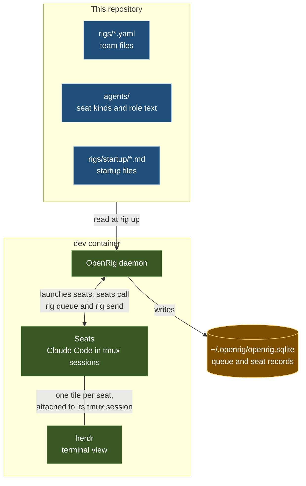
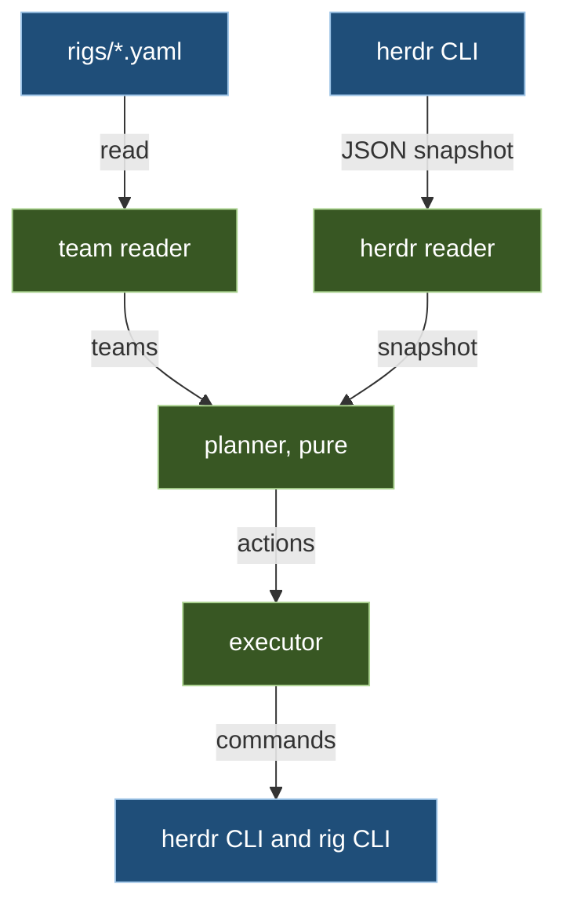
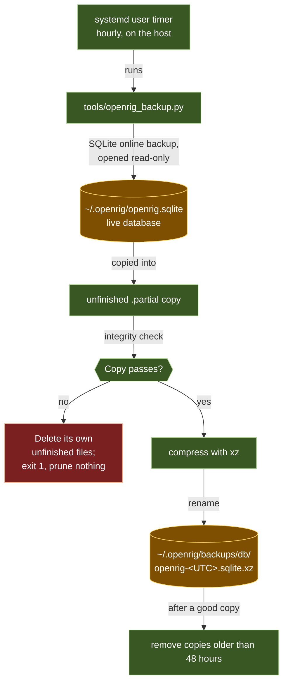
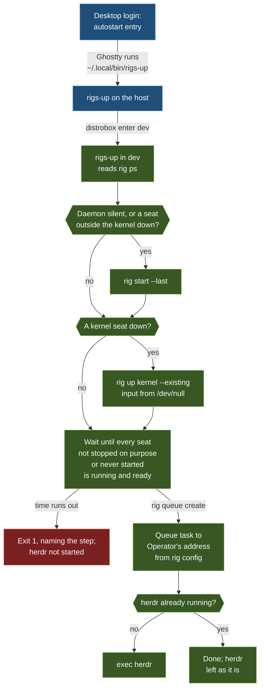
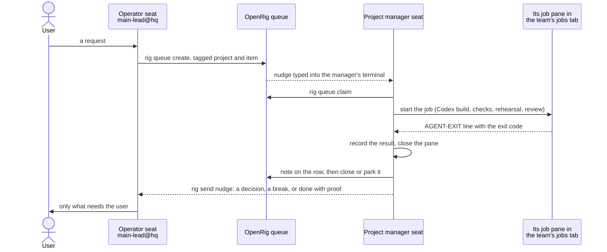

# Architecture

This repository holds the files that define the OpenRig teams, the code that lays those teams out
on screen, and the tools that keep them running. OpenRig runs each team as a rig of Claude Code
seats in tmux, and herdr is the terminal view that shows every seat. The design decisions
behind it live in the vault, in the OpenRig team project note (decisions 5 to 15) and the Workflow
upkeep project note (decision 80).

## The shape

Three kinds of thing live here.

The **team files** are data. Each file in `rigs/` is an OpenRig RigSpec for one team: a program,
a board's projects in no program, or the service owners. Its pods are one per project or domain,
plus a program manager's pod in a program's team, and each pod's seats carry the seat's role,
working folder, permission policy, denied tools and declared herdr name
(`env: {AGENT_NAME: <name>}`). The folders in `agents/` define each kind of agent (Workflow engine
decision 49, Work system decision 28): Operator, the program manager, the project manager and the
service owner for seats, and the builder, reviewer, investigator and specialist for workers. Each
folder holds the kind's agent spec, its role text and its own Claude settings file. A spec can hold
several profiles, so the program manager has one per program and the service owner one per domain.
OpenRig reads these files when a team is brought up; nothing in this repository runs them.

This diagram shows how the team files become running seats. OpenRig's daemon reads them when a
team is brought up, launches each seat as Claude Code in its own tmux session, and records the
queue and every seat in one SQLite file; herdr shows each seat in a tile attached to that session.

The **team-view step** is code, still to be built (OpenRig team decision 14). It makes each team's
herdr space look the way the team files say it should: one workspace per team, the seats' tiles
in tabs of at most four with readable names, and every agent tile named with its declared name.
It reads the team files and herdr's current state, works out what is missing, and asks herdr and
OpenRig to make the changes. It runs after every power-on and whenever a team's view is needed,
and running it twice changes nothing the second time.

The planned step has five parts, shown below: two readers, a pure planner, an executor, and the
command that runs them (in the table under "The pieces").

The **operational tools** keep a running team safe. The first is the database backup (OpenRig
team decision 15). OpenRig's queue is the only record of open work between agents (Workflow
engine decision 31), and it lives in one SQLite file, `~/.openrig/openrig.sqlite`. Every hour a
systemd user timer on the host runs `tools/openrig_backup.py`, which copies that file with
SQLite's online backup while the daemon keeps writing, checks the copy, compresses it, and keeps
48 hours of copies in `~/.openrig/backups/db/`. It runs on the host, not in a container, because
nothing has to be installed for it there, and because a container would have to relabel the live
OpenRig folder for SELinux. A copy of the script and its units is installed from a merged
commit, so the timer never runs whatever branch a checkout happens to be on.

This diagram follows one hourly run, including what happens when a copy fails its check.

The second is `rigs-up` (OpenRig team decision 17), the one command that restarts everything after a power loss.
It brings every team back in the only order that works: OpenRig first, then the kernel without
its stopped advisor, then a wait until every seat is up, and herdr last, because a herdr tile whose
seat isn't up fails instead of waiting. It judges what to start and when it's done from OpenRig's
own record of each seat, `rig ps --nodes -A --json`, including which seats were stopped on
purpose and which were recorded but never started. So it holds no list of teams or seats, and
running it twice starts nothing the second time. herdr is started only when
`herdr status server --json` doesn't report `"running": true`;
a running herdr is left alone rather than given another client. At login, the desktop autostart
entry `autostart/rigs-up.desktop` opens a Ghostty window that runs it, so after a power-off nothing
has to be typed.

This diagram follows rigs-up from login to herdr, with each decision it makes from `rig ps`.

## How work moves between seats

The user talks to one seat, Operator, `main-lead@hq`. Each active project has a project manager,
which runs that project's work, and each domain's running systems have a service owner. A program
manager keeps each program's charter and roadmap, and isn't on the path between them. Project
managers and service owners consult each other directly (Workflow engine decision 49). Requests
between seats travel on OpenRig's queue, addressed by OpenRig address and tagged with the project
and item, and a `rig send` nudge wakes the seat that owns a row. A stopped seat isn't woken by a
row, so whoever sends it work starts it first with `rig launch`. A manager doesn't do jobs in its
own session. Each job, whether a Codex build through the build loop, a test run, a CI rehearsal or
a review, runs in its own labelled pane in the team's shared `jobs` tabs in herdr, and ends with
an `AGENT-EXIT` line that the manager waits on. The manager records the result on the row, closes
the pane, and nudges Operator only for a decision, a break, or work done with proof.

This diagram follows one request from the user to a project manager's job pane and back.

## The pieces

| Piece | Responsibility | Interface | Depends on | How it fails | Must not |
|---|---|---|---|---|---|
| `rigs/*.yaml` | Define each team, its seats and each seat's herdr name | OpenRig RigSpec 0.2, checked with `rig spec validate` | `agents/` | `rig spec validate` names the bad field | hold secrets; name a seat outside herdr's rule `[a-z][a-z0-9_-]{0,31}` |
| `agents/` | Define each kind of agent, its role text and its Claude settings file | OpenRig agent specs | OpenRig's shared agent spec | `rig up` refuses a missing or invalid spec | carry one project's details; those go in the team file's startup file |
| Team reader (planned) | Turn the team files into a list of teams, each with its seats' sessions, labels and names | a function returning plain data | PyYAML | raises on a file that isn't valid YAML or lacks a field it needs | run a command, or read anything but `rigs/` |
| herdr reader (planned) | Take a snapshot of herdr: workspaces, tabs, panes, agent names, and which seat each tile attaches to | a function returning plain data | the `herdr` CLI's JSON output | raises when herdr can't be reached or answers in a shape it doesn't know | change anything in herdr |
| Planner (planned) | Compare the teams with the snapshot and list the actions that close the gap | a pure function, teams plus snapshot in, actions out | nothing | it can't fail at run time; a team it can't place is reported as an action that needs a person | call a command, read a file, or plan any change to a team's shared `jobs` tabs |
| Executor (planned) | Carry out the actions in order and report each result | a function taking the actions | the `herdr` and `rig` CLIs | stops at the first failed action, reports it and exits nonzero | close a pane, or carry out an action the planner didn't list |
| Command (planned) | Run the step for every team or one team, with a dry run that prints the plan | `team-view [--team <rig>] [--dry-run]` | all of the above | exit 0 when done or nothing to do, 1 when an action failed, 2 on bad input | prompt for input |
| `tools/openrig_backup.py` | Copy OpenRig's database, check the copy, compress it, keep it for 48 hours, and remove older copies after a good one | `openrig_backup.py [--db PATH] [--dest DIR] [--keep-hours N]`, run by `/usr/bin/python3` | Python's standard library only (`sqlite3`, `lzma`) | exit 1 with one line on standard error when the database can't be read or the copy fails its check, after deleting its own unfinished files; nothing is pruned after a failure; exit 2 on bad arguments | write to the live database, open it any way but read-only, or delete a file in the copies folder whose name isn't one of its own copies or unfinished files |
| `systemd/openrig-backup.service`, `.timer` | Run the backup hourly on the host, catching up on a missed hour | systemd user units, installed as copies under `~/.config/systemd/user/` | systemd's user manager, `/usr/bin/python3` | a failed run shows as a failed unit in `systemctl --user status` | run anything but the installed copy of the script |
| `tools/rigs_up.py` | Bring every OpenRig team back after a reboot, then open herdr unless it is already running | `rigs-up [--wait-seconds N] [--poll-seconds N]`, installed as a copy at `~/.local/bin/rigs-up` and run by `/usr/bin/python3` on the host or in dev | the `rig`, `herdr` and `distrobox` CLIs; Python's standard library | exit 1 with one line naming the step when the daemon doesn't answer or seats aren't up in time, before herdr starts, or when herdr can't be started; exit 2 on bad arguments | start a seat OpenRig records as stopped on purpose, attach another client to a running herdr, answer `rig up`'s fresh-session question, hold its own list of teams or seats, or change the team files |
| `autostart/rigs-up.desktop` | Run rigs-up at login in a Ghostty window | a desktop autostart entry, installed as a copy in `~/.config/autostart/` | the desktop's autostart, Ghostty (`-e`), `~/.local/bin/rigs-up` | if rigs-up fails, its window shows the failing step; if the entry is missing, nothing starts and `rigs-up` can be typed by hand | run anything but the installed `rigs-up` |

The planner is pure so that every rule about what a team's space should look like can be tested
without herdr or OpenRig running, and so its mutants can be killed by ordinary tests.

## Rules every piece follows

- **The CLIs are the authority.** The step changes herdr only through the `herdr` CLI and OpenRig
  only through the `rig` CLI. It never writes herdr's `session.json`, tmux's environment or
  OpenRig's database.
- **A tile is mapped to its seat from herdr itself.** `herdr pane process-info --pane <id>` shows
  the tile's attach script, whose arguments carry the seat's session name after `openrig-tile`.
- **A team that already has tiles is never reopened.** Once a team's tab has been renamed,
  `rig terminal open <rig>` no longer recognises the view and opens a duplicate workspace. The step
  opens a view only for a team with no tiles at all.
- **The seat's name comes from its team file.** The step reads `AGENT_NAME` from the seat's tmux
  session when it is set, and from the team file otherwise, because a running seat only gets a
  newly declared name at its next launch.
- **Job tabs belong to the seats.** The step never creates, changes or closes the shared tabs
  named `jobs` or `jobs N`, or any pane in them (Workflow upkeep decision 80).
- **Seats never get `HERDR_PANE_ID` or `HERDR_WORKSPACE_ID`.** With them, claude-config's
  herdr-name hook would rename every seat after its workspace.
- **Pinned tools.** Every dependency and CI action is pinned to an exact version or commit.
- **Operational tools use only the host's standard library.** The host has no Node, no Go and no
  extra Python packages, and a backup must run when other things are broken, so a tool here
  imports nothing outside Python's standard library.
- **Tests run as `python -m pytest` from the repository root.** No `pythonpath` setting and no
  `sys.path` edits in a conftest, because mutmut swaps in its own copy of `tools/` and either one
  makes every mutant look untested.
